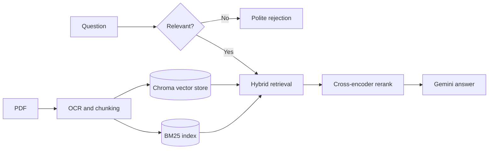

# RAG Project

A retrieval-augmented generation pipeline that answers questions about your PDF documents. It combines semantic and keyword search, reranks the results with a cross-encoder, and generates grounded answers with Gemini. The pipeline is orchestrated with LangGraph and instrumented with Prometheus and Grafana.

## Features

- **Hybrid retrieval.** Semantic search over a Chroma vector store and keyword search with BM25, merged and de-duplicated.
- **Cross-encoder reranking.** Retrieved chunks are rescored against the question and low-scoring chunks are dropped before generation.
- **Query grading.** Greetings and off-topic messages are filtered out before any retrieval happens.
- **Grounded answers.** The answer model is instructed to use only the retrieved context.
- **Ingest once.** A PDF is processed and embedded on the first run only. Later runs reuse the chunks stored on disk.
- **Observability.** Time to first token, end-to-end latency, tokens per second and per-step latency are exported to Prometheus, with a ready-made Grafana dashboard.

## How it works



Ingestion runs outside the graph and must happen before any question is asked. The LangGraph state carries five fields: `query`, `is_relevant`, `docs`, `ranked_docs` and `answer`.

| Step | Implementation |
|---|---|
| Text extraction | PyMuPDF renders each page to an image, Tesseract reads the text |
| Chunking | `RecursiveCharacterTextSplitter`, 500 characters with 20 overlap |
| Embeddings | `sentence-transformers/all-MiniLM-L6-v2` |
| Vector store | Chroma, persisted to `chroma_db/` |
| Keyword search | BM25, rebuilt in memory on each run |
| Reranker | `cross-encoder/ms-marco-MiniLM-L-6-v2`, top 5 above a score threshold |
| Language model | Gemini, through LangChain agents with structured output |

## Project structure

```
Rag_project/
├── demo.py                     Runs ingestion and one question end to end
├── server.py                   Optional API server that keeps the models loaded
├── requirements.txt
├── src/
│   ├── agents/
│   │   ├── formal_agent.py     Grades whether a question is relevant
│   │   └── rag_agent.py        Generates the answer from retrieved context
│   ├── data_stores/
│   │   ├── vector_store.py     Chroma store and embedding model
│   │   └── bm25.py             BM25 keyword store
│   ├── document_loders/
│   │   ├── pdf_loders.py       PDF to chunks
│   │   └── table_loders.py     CSV to chunks (work in progress)
│   ├── reranker/               Cross-encoder reranker
│   ├── pipeline/
│   │   └── pipe.py             LangGraph pipeline, ingestion and metrics
│   └── monitoring/
│       └── metrics.py          Prometheus metric definitions
├── utils/                      PDF rendering, OCR and text splitting helpers
└── monitoring/
    ├── docker-compose.yml      Prometheus and Grafana
    ├── prometheus/             Scrape configuration
    └── grafana/                Data source and dashboard provisioning
```

## Getting started

### Prerequisites

- Python 3.11 or newer
- [Tesseract OCR](https://github.com/UB-Mannheim/tesseract/wiki), available on your `PATH`
- A Google Gemini API key
- Docker Desktop, only if you want the monitoring stack

On Windows, Tesseract can be installed with:

```powershell
winget install UB-Mannheim.TesseractOCR
```

Then add `C:\Program Files\Tesseract-OCR` to your `PATH` and open a new terminal.

### Installation

```bash
git clone https://github.com/Debtanu2005/Rag_project.git
cd Rag_project
pip install -r requirements.txt
```

### Configuration

Create a `.env` file in the project root:

```
GOOGLE_API_KEY=your-key-here
```

The file is listed in `.gitignore`. Do not commit your key.

## Usage

Set the question and the PDF path at the top of `demo.py`:

```python
QUERY = "What is naive bayes algorithm?"
PDF_PATH = r"path\to\your.pdf"
```

Run it from the project root:

```bash
python demo.py
```

The script ingests the PDF, answers the question and prints both:

```
Question: What is naive bayes algorithm?
Answer: ...
```

The first run performs OCR on every page and can take a few minutes. Later runs print `Using N stored chunks` and skip that step.

### Using the pipeline in your own code

```python
import sys
from dotenv import load_dotenv

load_dotenv()            # the API key must be loaded before the pipeline is imported
sys.path.insert(0, "src")

from pipeline.pipe import ingest_documents, run_pipeline

ingest_documents(["lecture.pdf"])
answer = run_pipeline("What is naive bayes algorithm?")
```

`run_pipeline` raises an error if no document has been ingested.

### Optional: keep the models loaded

Every run of `demo.py` loads the embedding model and the reranker again, which takes about 30 seconds. `server.py` loads them once and serves requests until you stop it:

```bash
python server.py
```

| Endpoint | Purpose |
|---|---|
| `POST /ingest` | Body `{"pdf_paths": ["file.pdf"]}` |
| `POST /query` | Body `{"query": "your question"}` |
| `GET /metrics` | Prometheus metrics |

## Monitoring

Start Prometheus and Grafana:

```bash
docker compose -f monitoring/docker-compose.yml up -d
```

| Service | URL |
|---|---|
| Pipeline metrics | http://localhost:8000/metrics |
| Prometheus | http://localhost:9090 |
| Grafana (login `admin` / `admin`) | http://localhost:3000 |

The dashboard is provisioned automatically under **Dashboards > RAG > RAG Pipeline**.

Metrics are only served while `demo.py` or `server.py` is running. `demo.py` stays alive for 10 seconds after printing the answer so that Prometheus can collect the run.

| Metric | Meaning |
|---|---|
| `rag_ttft_seconds` | Time from receiving the question to the first answer token |
| `rag_request_latency_seconds` | End-to-end time for one question |
| `rag_tokens_per_second` | Answer generation speed after the first token |
| `rag_node_latency_seconds` | Time spent in each pipeline step |
| `rag_requests_total` | Requests by outcome: answered, rejected or error |
| `rag_output_tokens_total` | Total answer tokens generated |

## Known limitations

- **OCR quality.** Every page is read with OCR, even when the PDF already contains selectable text. Equations and annotated slides can come out garbled, which may cause the model to reply that it does not have enough information.
- **Stored chunks are keyed by file path.** If you edit a PDF without renaming it, the old chunks are reused. Delete `chroma_db/` to force a fresh ingestion.
- **Run from the project root.** `chroma_db/` is a relative path, so running from another folder creates a new, empty store.
- **CSV ingestion is not wired in.** `table_loders.py` is not yet used by the pipeline.

## License

Released under the [MIT License](LICENSE).
